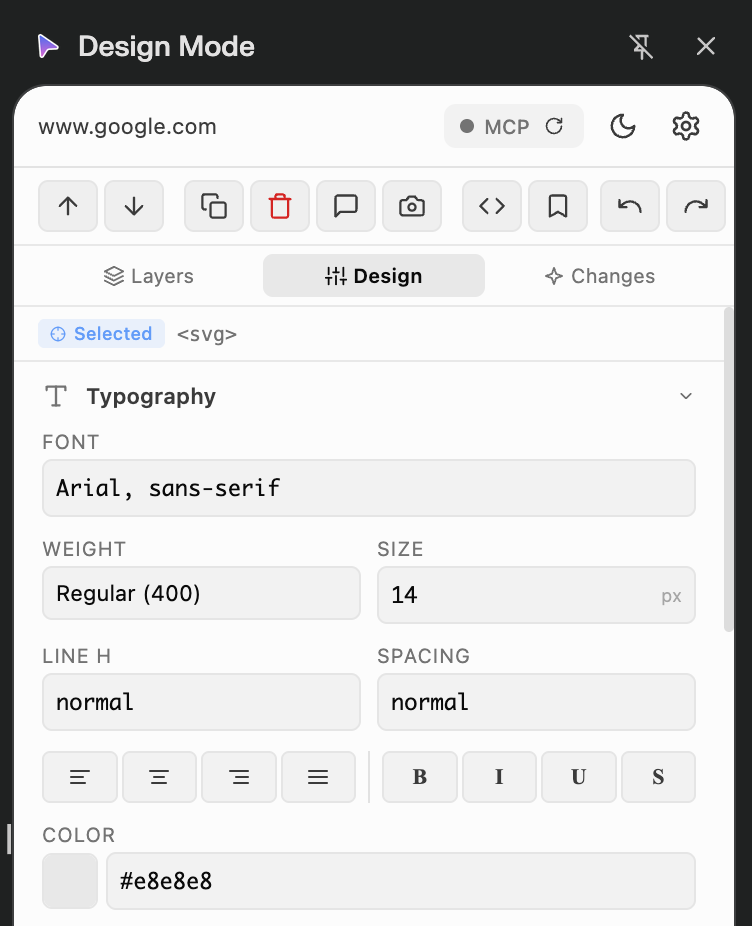

# Design Mode

A free, open-source browser extension that lets you edit a rendered webpage, record the exact changes, and hand them to a coding agent. The browser edit is a preview. The agent updates source in a repository it can access.



## What it does

- Inspect an element and change layout, type, colour, spacing, effects and motion on a scriptable page.
- Record style, text, DOM and comment changes in the Changes tab.
- Copy those changes as a Markdown prompt, or send them to a connected agent through MCP.
- Works in Chrome, Firefox and Safari. Pop-out, Picture-in-Picture and the screen eyedropper are Chromium-only.

It does not deploy a site or bypass login. Localhost, staging and a tab you are already signed into work when the page can be scripted.

A short walkthrough: [designmode.app](https://designmode.app/) (video on the homepage) and [the demo](https://designmode.app/demo).

## Install

- **Chrome** (and other Chromium browsers): [Chrome Web Store](https://chromewebstore.google.com/detail/design-mode/ighgobegfcmjagombgnfhgioflinojih).
- **Firefox** 140+: [Firefox Add-ons](https://addons.mozilla.org/firefox/addon/design-mode-add-on/).
- **Safari** on Mac: download `designmode-for-safari.zip` from the [latest GitHub release](https://github.com/SandeepBaskaran/design-mode/releases/latest), then add it as a temporary extension in Safari Settings → Developer. Safari removes temporary extensions when it quits.
- **CLI:** the executable is `designmode-app` from `@designmode-app/cli`. It prints its version with `designmode-app version` and does not start the local bridge by itself. Setup and the current publish state are in [packages/cli/README.md](packages/cli/README.md).

Pin the extension, open a page, and click the toolbar icon. Chrome opens the launch surface chosen in Settings. Firefox opens its sidebar.

## Quick start

1. Install the extension and open it on a page you can script, such as your dev server.
2. Select an element, make the change, and check the Changes tab.
3. Copy as Prompt, or connect an agent from [the MCP page](https://designmode.app/mcp), then review the source diff.

## Go deeper

- [Who it’s for](https://designmode.app/use-cases)
- [Connect an agent](https://designmode.app/mcp)
- [MCP setup](https://designmode.app/blog/mcp-setup)
- [Browser support](https://designmode.app/blog/browser-support)
- [Changes tab](https://designmode.app/blog/changes-tab)
- [Keyboard shortcuts](https://designmode.app/blog/keyboard-shortcuts)
- [Troubleshooting](https://designmode.app/blog/troubleshooting)
- [Compare](https://designmode.app/compare)
- [Blog](https://designmode.app/blog)
- [Changelog](https://designmode.app/changelog)

## Privacy, security, licence

Release builds send bounded usage events. They do not send page content, selectors, comments or screenshots. Details, storage and the Cloud relay are in [PRIVACY.md](PRIVACY.md).

Report vulnerabilities through [SECURITY.md](SECURITY.md). The licence is [MIT](LICENSE).

## For contributors

```bash
npm ci
npm run dev:extension    # build the extension once
npm run dev:website      # website
npm run verify           # the same gate CI runs
```

The manual checklist is [docs/e2e-testcases.md](docs/e2e-testcases.md). Contribution rules are in [CONTRIBUTING.md](CONTRIBUTING.md). By participating you agree to the [Code of Conduct](CODE_OF_CONDUCT.md).
